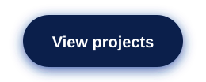
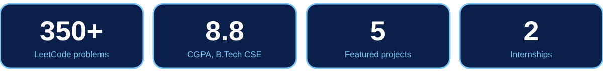
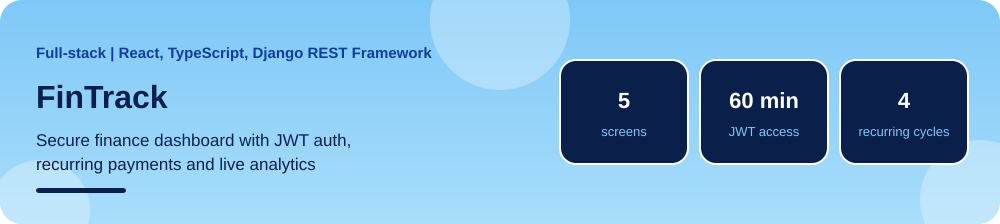
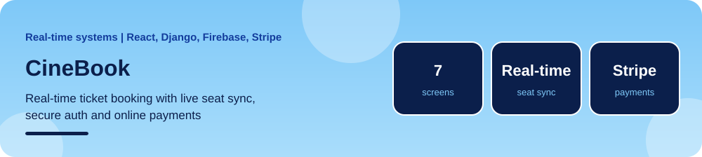
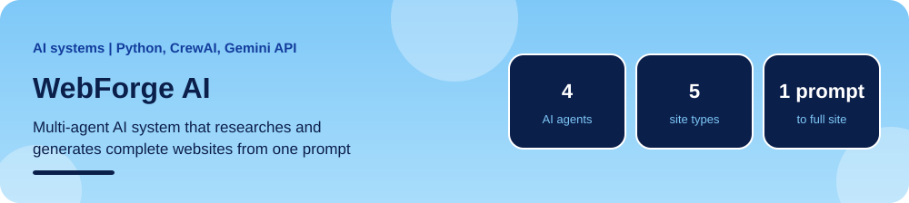
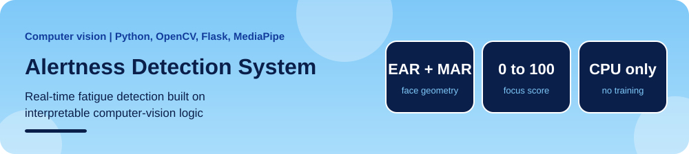
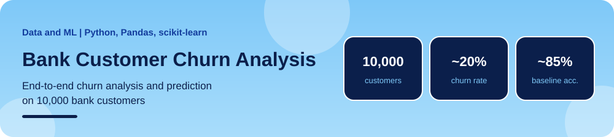
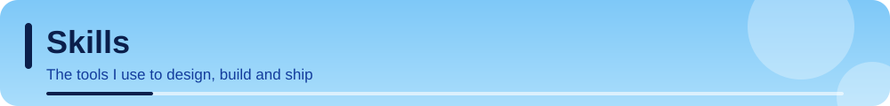
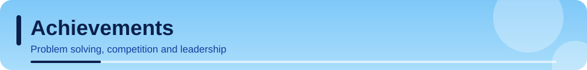

      

 

 

<table><tr>
<td width="62%" valign="top">

Hi, I'm Gowni Venkat Charan, a final-year Computer Science student at Madanapalle Institute of Technology and Science (B.Tech CSE, CGPA 8.8, graduating May 2027), aiming for Software Development Engineer roles.

I turn strong data structures and algorithms fundamentals (350+ LeetCode problems) into production-style full-stack systems with React.js and Django, working in Python, Java and C. I care about security, reliability and clean engineering: JWT authentication, input and output validation, real-time data sync and configuration-driven design.

I also lead as a Technical Team Lead at the Code Club of MITS, one of 5 leads for a club of 1200+ students.

<h3>What I focus on</h3>

<ul><li><b>Problem solving:</b> Daily DSA practice on LeetCode and HackerRank, with a focus on clear, efficient solutions.</li><li><b>Full-stack products:</b> React.js frontends talking to Django REST Framework backends, with JWT auth, payments and real-time data.</li><li><b>Applied ML and AI:</b> Random Forest classification, facial landmark detection, multi-agent systems and exploratory data analysis.</li><li><b>Leadership:</b> Helping run technical events and a 1200+ student club as one of 5 team leads.</li></ul>

</td>
<td width="38%" valign="top">

<h3>Quick facts</h3>

<b>Looking for:</b> SDE and full-stack roles <b>Based at:</b> Madanapalle, Andhra Pradesh <b>Main languages:</b> Python, Java, C <b>Favorite stack:</b> React.js, Django REST Framework, MySQL <b>Graduating:</b> May 2027

</td>
</tr></table>

<table><tr>
<td width="60%" valign="top"><b>What I built</b><ul><li>Built a full-stack expense tracker with React, TypeScript and Django REST Framework, delivering 5 responsive screens for tracking, reviewing and planning spending</li><li>Secured the REST API with JWT: 60-minute access tokens and refresh-token rotation, so each user only reaches their own data</li><li>Implemented recurring payments across 4 frequencies, plus CSV import and export for data portability</li><li>Created interactive dashboards and reports with Recharts, alongside expense search, categories, tags and filterable history</li><li>Designed a graceful fallback to local storage for selected features when the backend is unreachable</li></ul></td>
<td width="40%" valign="top"><b>Tech stack</b>
     
<b>How it works</b>
A React and TypeScript client talks to a JWT-protected Django REST Framework API through Axios. SQLite is used in development and the database layer can be swapped to MySQL or PostgreSQL.

<a href="https://github.com/Chintucharan/expense-tracker-fullstack"><b>View source on GitHub</b></a>
</td>
</tr></table>

<b>Roadmap</b> (click to open)

Budgets and alerts, multi-currency support, XLSX and Google Sheets export, PWA and offline mode.

<table><tr>
<td width="60%" valign="top"><b>What I built</b><ul><li>Engineered real-time seat synchronization with Firebase, so seats taken by other users update instantly for every client and double-booking risk drops</li><li>Built secure authentication with Firebase Authentication, with the Django backend verifying every user through the Firebase Admin SDK</li><li>Integrated Stripe to process online card payments, with live payment status and instant booking confirmation</li><li>Designed REST APIs for movies, showtimes and bookings, plus an interactive seat map, booking history and 7 responsive screens</li><li>Organized the backend into separate apps for movies, bookings and users to keep the codebase maintainable</li></ul></td>
<td width="40%" valign="top"><b>Tech stack</b>
     
<b>How it works</b>
The frontend signs users in with Firebase and subscribes to live seat data. The backend verifies identity, manages bookings and handles payments, while Firebase keeps all connected clients in sync.

<a href="https://github.com/Chintucharan/real-time-movie-booking-system"><b>View source on GitHub</b></a>
</td>
</tr></table>

<b>Roadmap</b> (click to open)

Temporary seat holds with a timeout, emailed tickets, an admin dashboard, Docker setup, automated tests and CI.

<table><tr>
<td width="60%" valign="top"><b>What I built</b><ul><li>Designed a multi-agent system of 4 specialized agents (research, HTML, CSS, JavaScript) orchestrated with CrewAI and the Gemini API</li><li>Generates 5 website types (business, portfolio, landing page, blog, e-commerce) from a single prompt</li><li>Grounded content in real information by giving agents web search through Serper</li><li>Built config-driven agents and tasks, with input validation and output validation that fail clearly instead of silently</li><li>Added a command-line interface for run, train, replay and test, and set up Black, isort, mypy, flake8 and pytest for code quality</li></ul></td>
<td width="40%" valign="top"><b>Tech stack</b>
   
<b>How it works</b>
A topic goes in, the research agent gathers information, and the HTML, CSS and JavaScript agents build the structure, styling and behavior. Finished files are saved to an output folder.

<a href="https://github.com/Chintucharan/aiagentwebsitebuilder"><b>View source on GitHub</b></a>
</td>
</tr></table>

<b>Roadmap</b> (click to open)

Richer templates per site type, automated tests and CI, and a hosted web interface.

<table><tr>
<td width="60%" valign="top"><b>What I built</b><ul><li>Built a real-time drowsiness and yawning detector (the Student Drowsiness and Yawning Detection System) from MediaPipe Face Mesh landmarks, streaming browser webcam frames to a Flask backend</li><li>Computed Eye Aspect Ratio and Mouth Aspect Ratio, with leaky frame counters that ignore normal blinks and cut false alarms</li><li>Chose a hybrid design: a pretrained landmark model plus transparent rules, so no dataset or training is needed and inference runs on CPU</li><li>Added a live 0 to 100 focus score, an audio alarm, motivational quotes and study tips</li><li>Exposed a Flask API (predict, status, quote) and made the app deploy-ready on Render with Gunicorn</li></ul></td>
<td width="40%" valign="top"><b>Tech stack</b>
     
<b>How it works</b>
EAR below 0.21 for 5 frames flags drowsiness and MAR above 0.55 for 4 frames flags yawning. The focus score drops by 3 or 2 per fatigued frame and recovers by 1 per focused frame.

<a href="https://github.com/Chintucharan/detection_system"><b>View source on GitHub</b></a>
</td>
</tr></table>

<b>Roadmap</b> (click to open)

Per-user calibration, time-based thresholds, head-pose detection, per-session state for multiple users and on-device inference.

<table><tr>
<td width="60%" valign="top"><b>What I built</b><ul><li>Analyzed 10,000 customers across 14 columns, covering data quality checks, descriptive statistics, correlation, outlier detection and visual exploration</li><li>Answered five business questions and found Germany churns about 32%, roughly double France and Spain, with the highest risk among customers in their 50s</li><li>Showed inactive members churn at about 27% versus 14% for active members, and that customers with 2 products are the most loyal</li><li>Trained logistic regression and decision tree baselines to roughly 85% accuracy, and noted that with about 80% of customers staying, recall and ROC-AUC matter more</li><li>Turned findings into recommendations such as targeting inactive customers aged 40+ and re-engaging 1-product customers</li></ul></td>
<td width="40%" valign="top"><b>Tech stack</b>
     
<b>How it works</b>
Clean the data, explore it, answer business questions with grouped statistics and charts, then fit baseline models and convert the results into retention actions.

<a href="https://github.com/Chintucharan/customerchurn"><b>View source on GitHub</b></a>
</td>
</tr></table>

<b>Roadmap</b> (click to open)

Gradient boosting with imbalance handling, customer segmentation and an interactive dashboard.

<table>
<tr><td width="28%" valign="top"><h3>Data Science Intern</h3><b>TechnoHacks Solutions</b> Jun - Aug 2025
   
</td><td valign="top"><ul><li>Built a Network Intrusion Detection System with a Random Forest classifier (Python, Scikit-learn) that labels traffic as normal or malicious at 90% accuracy on 10K+ records</li><li>Engineered model-ready features from raw network traffic captured and parsed with Scapy and PyShark</li><li>Persisted the trained model with Joblib and deployed predictions through a Flask dashboard, so no retraining is needed at runtime</li><li>Visualized traffic patterns and model performance with Matplotlib and Seaborn</li><li>Chose Random Forest for its strength on mixed tabular data, resistance to overfitting and feature-importance insight</li></ul>
<a href="https://github.com/Chintucharan/Network_Intrusion_Detection_System"><b>View source on GitHub</b></a>
</td></tr>
<tr><td width="28%" valign="top"><h3>Web Developer Intern</h3><b>Codec Technologies</b> Dec 2025
   
</td><td valign="top"><ul><li>Built and deployed a responsive Simon-style memory game (Color Mania) on GitHub Pages</li><li>Implemented level-based scoring and per-click validation that checks each click against the expected sequence position in constant time</li><li>Managed game state without a framework and coordinated timed visual feedback, with separate flash styles for playback and player input</li><li>Delivered a layout that works on desktop and mobile using vanilla HTML, CSS and JavaScript with no dependencies</li></ul>
<a href="https://github.com/Chintucharan/simongame"><b>View source on GitHub</b></a> &nbsp;|&nbsp; <a href="https://chintucharan.github.io/simongame/"><b>Live demo</b></a>
</td></tr>
</table>

<table>
<tr><td width="26%" valign="top"><b>Languages</b></td><td>   Python for backends, ML and agents; Java and C for DSA and fundamentals.</td></tr><tr><td width="26%" valign="top"><b>Frontend</b></td><td>    Responsive interfaces, charts and real-time UIs.</td></tr><tr><td width="26%" valign="top"><b>Backend and databases</b></td><td>    REST APIs, JWT security and relational data.</td></tr><tr><td width="26%" valign="top"><b>Core concepts</b></td><td>    The foundation behind 350+ solved problems.</td></tr><tr><td width="26%" valign="top"><b>Data and machine learning</b></td><td>        Classification, computer vision, EDA and multi-agent workflows.</td></tr><tr><td width="26%" valign="top"><b>Tools and services</b></td><td>      Authentication, payments, styling and deployment.</td></tr>
</table>

<table>
<tr><td width="50%" valign="top"><h3>350+ LeetCode problems</h3>
Solved across arrays, strings, trees, graphs and dynamic programming. Regular practice built speed, clean code habits and confidence in technical interviews.
</td><td width="50%" valign="top"><h3>HackerRank 5-star badges</h3>
Earned 5-star Python and SQL badges, showing strong command of the core language and of database querying.
</td></tr>
<tr><td width="50%" valign="top"><h3>Smart India Hackathon 2025</h3>
Participated in India&#8217;s national hackathon, working in a team to design a solution for a real problem statement under time pressure.
</td><td width="50%" valign="top"><h3>Technical Team Lead, Code Club</h3>
One of 5 leads for a club of 1200+ students at MITS. Organized 2 technical events across college fests and hackathons.
</td></tr>
</table>

<table><tr><td width="75%" valign="top"><h3>B.Tech in Computer Science and Engineering</h3><b>Madanapalle Institute of Technology and Science (MITS)</b> Graduating May 2027<ul><li>Final-year student aiming for SDE roles</li><li>Technical Team Lead, Code Club, MITS</li><li>Core subjects: data structures and algorithms, OOP, DBMS and REST APIs</li></ul></td><td align="center"><h2>8.8</h2><b>CGPA</b></td></tr></table>

<h2 align="center">GitHub activity</h2>

I&#8217;m open to SDE roles, internships and collaborations.

   

 

